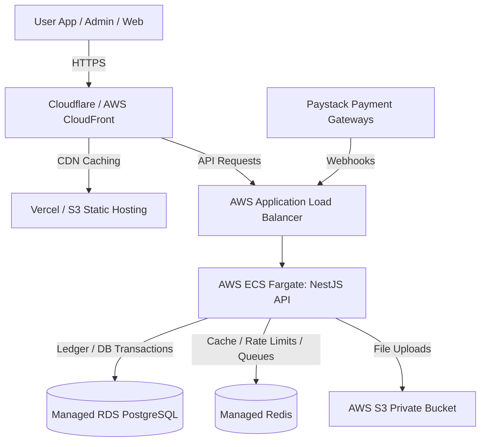

# SK Cybernet Phased Implementation Master Plan

This document breaks down the implementation of SK Cybernet into granular, sub-indexed execution steps. It is derived from [implementation.md](file:///c:/Users/admin/Desktop/SK%20Cybernet/implementation.md) and represents the master blueprint for the engineering team.

---

## 🎨 Visual Identity & Style System Specifications

To achieve a premium, trustworthy fintech appearance, the applications must strictly adhere to the following visual design constraints:

*   **Primary Font:** **Inter** (Google Fonts). Use Inter for all UI elements, navigation, input fields, tables, and numerical balances to ensure geometric clarity and clean readability. Headings can optionally use **Outfit** for a premium sans-serif contrast.
*   **Color Palette (Blue and White Theme):**
    *   **Primary Deep Blue:** `#0F172A` (Tailwind `slate-900`) or a rich navy `#0A192F` / `#002D62`. Used for persistent app navigation, balance cards, primary action buttons, and dark mode backgrounds.
    *   **Pure White:** `#FFFFFF`. Used for the main card surfaces, content container backgrounds, and clean light-mode surfaces.
    *   **Accent Slate/Blue:** `#3B82F6` (Tailwind `blue-500`) or `#2563EB` (Tailwind `blue-600`) for active states, indicators, and success badges.
    *   **Neutral Off-White/Light Gray:** `#F8FAFC` (Tailwind `slate-50`) or `#F1F5F9` (Tailwind `slate-100`) for page-level backgrounds and subtle borders.
*   **Emojis:** **Do not use emojis** anywhere in the product interfaces. Use clean, high-quality vector icons (such as `lucide-react` or similar custom assets).

---

## Phase 0: Project Setup & Monorepo Configuration

**Goal:** Establish the monorepo foundation, build-pipeline, developer tooling, and containerized local services.

### 0.1 Monorepo & Workspaces
- `[ ]` Initialize git repository and standard monorepo folder layout.
- `[ ]` Configure Turborepo (`turbo.json`) to manage task pipelines (build, lint, test) with caching.
- `[ ]` Configure global `package.json` with npm workspaces.

### 0.2 Tooling & Shared Configs
- `[ ]` Setup shared TypeScript config (`packages/config/typescript`).
- `[ ]` Setup shared ESLint and Prettier rule packages.
- `[ ]` Setup Tailwind CSS configuration preset (`packages/config/tailwind`) featuring the core **Blue and White** color theme.

### 0.3 Application Scaffolding
- `[ ]` Scaffold Next.js public marketing site: `apps/web` (App Router, TypeScript).
- `[ ]` Scaffold Next.js user PWA: `apps/app` (App Router, TypeScript, PWA-configured manifest).
- `[ ]` Scaffold Next.js admin console: `apps/admin` (App Router, TypeScript).
- `[ ]` Scaffold NestJS API: `apps/api` (TypeScript, module architecture).

### 0.4 Shared Package Utilities
- `[ ]` Create `packages/types` to hold API contracts, DTOs, and TS interfaces.
- `[ ]` Create `packages/utils` for formatting (Naira to Kobo, credits, dates) and shared validators.
- `[ ]` Create `packages/ui` for common UI components (buttons, input fields using **Inter** font and primary colors).

### 0.5 Local Dev Environment
- `[ ]` Create a local `docker-compose.yml` defining:
    - PostgreSQL database container.
    - Redis cache and job queue container.
- `[ ]` Create and distribute `.env.example` files containing non-sensitive keys.

---

## Phase 1: Database & Core API Foundation

**Goal:** Establish database schemas, ORM migrations, connection pooling, and the core NestJS API framework.

### 1.1 Prisma Setup & Migrations
- `[ ]` Install Prisma in `apps/api` and link to the monorepo.
- `[ ]` Write the schema definition (`schema.prisma`) mapping all entities (User, Auth, Wallet, Subscription, Booking, Coupon, Transaction, Dispute, StudentVerification, AuditLog).
- `[ ]` Create initial database migration and apply it to the local PostgreSQL container.

### 1.2 Data Seeding
- `[ ]` Implement a database seed script to insert initial hub subscription tiers:
    - **Daily Subscription**
    - **Weekly Subscription**
    - **Monthly Subscription**
- `[ ]` Set up script run validation during local Docker spin-ups.

### 1.3 NestJS Core Infrastructure
- `[ ]` Configure NestJS database connection module with Prisma.
- `[ ]` Implement global filters (for consistent API error responses) and pipes (validation).
- `[ ]` Integrate Swagger (OpenAPI) for automated API route documentation.

---

## Phase 2: Authentication, Identity, & Onboarding Security

**Goal:** Create secure onboarding flows, SMS OTP verification, PIN handling, and Next.js/NestJS auth state integration.

### 2.1 Basic Authentication Core
- `[ ]` Create database entities and hashing helpers (using Argon2/bcrypt) for passwords.
- `[ ]` Build email/password registration and login endpoints.
- `[ ]` Build Google OAuth integration on the NestJS backend and PWA client.

### 2.2 Onboarding Completion Guards
- `[ ]` Implement backend checks that verify if user has completed all onboarding requirements:
    1. Set account password (for Google OAuth users).
    2. Verify phone number via SMS OTP.
    3. Setup 6-digit Login PIN.
    4. Setup 4-digit Payment PIN.
- `[ ]` Build NestJS router guards that intercept all profile, wallet, and booking requests if onboarding is incomplete.

### 2.3 Redis-Backed OTP Verification
- `[ ]` Implement Redis-based OTP generator (6-digit, 5-minute expiry).
- `[ ]` Add SMS provider service mock/stub on backend.
- `[ ]` Enforce rate-limiting for OTP requests (e.g. maximum 1 request per minute).

### 2.4 PIN Security
- `[ ]` Implement endpoints to set and verify the 6-digit Login PIN and 4-digit Payment PIN.
- `[ ]` Ensure PIN inputs are never stored in plaintext and never logged.
- `[ ]` Create a Redis-based attempt tracker to lock accounts after 5 consecutive failed PIN entries.

### 2.5 User PWA Onboarding UI
- `[ ]` Build the auth flow interface using the **Inter** font, featuring clean input fields.
- `[ ]` Build password setup, OTP confirmation screen, Login PIN setup, and Payment PIN setup screens.

---

## Phase 3: Wallet Funding & Paystack Payment Integration

**Goal:** Implement webhook-driven wallet funding and automated currency/credit ledger conversion.

### 3.1 Customer Profile & Transaction Init
- `[ ]` Integrate Paystack SDK into NestJS backend.
- `[ ]` Create Paystack Customer profile when onboarding completes.
- `[ ]` Implement an endpoint to initiate a Paystack card transaction.

### 3.2 Webhook & Dedicated Virtual Accounts
- `[ ]` Implement a secure NestJS endpoint to receive Paystack webhook events.
- `[ ]` Verify Paystack HMAC signature on incoming webhooks.
- `[ ]` Implement Dedicated Virtual Account request flow upon successful user registration.

### 3.3 Idempotency & Wallet Ledger Creation
- `[ ]` Store raw webhook event logs for auditing.
- `[ ]` Check Paystack reference numbers in Redis/DB to prevent duplicate credit postings.
- `[ ]` Establish database transaction for wallet balance adjustments:
    - Post settled cash amount to the transaction ledger.
    - Convert to credits at the current active rate.
    - Update `Wallet` available credit balance.

### 3.4 PWA Wallet Interface
- `[ ]` Build user-facing dashboard displaying the primary balance card (with a toggle to hide value).
- `[ ]` Display Virtual Account Details (Bank Name, Account Number, Reference Name).
- `[ ]` Show wallet transaction history with status badges (successful, pending, failed).

---

## Phase 4: Credit Wallet & Hub Subscriptions

**Goal:** Establish credit conversion tracking and configure hub subscription pricing tiers (with student discounts).

### 4.1 Credit Balance Ledger
- `[ ]` Ensure credit updates are append-only.
- `[ ]` Implement backend ledger tracking for all credit spends, conversions, and admin-issued adjustments.

### 4.2 Hub Subscription Tier Management
- `[ ]` Implement API endpoints to fetch active Hub Subscription Tiers (Daily, Weekly, Monthly).
- `[ ]` Create database entries to manage credit costs, durations, and student discounts.

### 4.3 Student Verification Pipeline
- `[ ]` Implement secure student document upload endpoint (accepts PDF/Image).
- `[ ]` Save student files to private object storage (private bucket layout).
- `[ ]` Implement student status states: `unverified`, `pending_review`, `verified`, `rejected`.
- `[ ]` Implement the student discount calculation logic (discount applied at booking checkout).

### 4.4 PWA Pricing UI
- `[ ]` Build subscription pricing UI in PWA, demonstrating clean cards for Daily, Weekly, and Monthly access tiers.
- `[ ]` Build Student ID upload and verification status component.

---

## Phase 5: Booking, Passes, & QR Code Check-In

**Goal:** Create space booking validation, generate Pass IDs/QR payloads, and handle check-in internet coupon code generation.

### 5.1 Booking Transaction Flow
- `[ ]` Write NestJS endpoint to book space using credits.
- `[ ]` Enforce transaction boundaries: check credit balance, debit credits, create booking, and generate Pass ID in a single atomic database statement.
- `[ ]` Verify user has a valid Payment PIN before confirming the transaction.

### 5.2 Pass & QR Generation
- `[ ]` Generate a unique public Pass ID (alphanumeric, e.g. `CYB-88392`) backed by a secure internal UUID.
- `[ ]` Generate a secure QR payload string containing encrypted user, booking, and check-in signatures.

### 5.3 QR Desk Check-In & 10-digit Numeric Coupon Generation
- `[ ]` Create an admin-only API check-in route that scans the booking QR code.
- `[ ]` Validate booking status (must be `confirmed` and current time must be within booking starts/ends windows).
- `[ ]` Transition booking status to `checked_in`.
- `[ ]` Auto-generate a unique **10-digit numeric coupon code** for internet access (e.g. `8392740192`).
- `[ ]` Link the generated internet coupon code to the booking and user records.
- `[ ]` Emit a notification to the user showing their internet access code.

### 5.5 PWA Passes View
- `[ ]` Build "My Passes" section in user app showing current active passes, upcoming bookings, and history.
- `[ ]` Build QR pass details screen.
- `[ ]` Render the generated 10-digit numeric internet coupon on the pass card once checked-in.

---

## Phase 6: Admin Operations Console

**Goal:** Provide operations staff with direct oversight of user accounts, disputes, student verifications, and check-ins.

### 6.1 Admin Dashboard & Navigation
- `[ ]` Build admin authentication and portal router guards.
- `[ ]` Create metrics summary page (active users, checked-in bookings, pending student verifications, dispute queues).

### 6.2 User & Wallet Oversight
- `[ ]` Build searchable user tables showing accounts, roles, and suspension flags.
- `[ ]` Build user details screen detailing credit ledger history, transaction logs, and action cards.
- `[ ]` Build account flagging/suspension control routes.

### 6.3 Student Verification Queue
- `[ ]` Build a queue displaying pending student uploads.
- `[ ]` Add private file viewer using **Pre-signed URLs** to render student ID documents securely.
- `[ ]` Build approve/reject action flows.

### 6.4 QR Check-In Scanner Page
- `[ ]` Integrate QR scanning library on `apps/admin` (using browser camera).
- `[ ]` Build admin scanner view that posts QR payload to backend check-in endpoint and displays check-in confirmation and the generated 10-digit numeric internet coupon.

### 6.5 System Audits & Price Adjustments
- `[ ]` Build interface for pricing configuration (Daily, Weekly, Monthly cost updates).
- `[ ]` Build manual ledger adjustment page (add/deduct credits) requiring reason text.
- `[ ]` Build audit log viewer capturing all admin sessions and actions.

---

## Phase 7: Public Marketing Web & Content

**Goal:** Build SEO-optimized public pages to drive conversions into the PWA.

### 7.1 Web Layout & Base Pages
- `[ ]` Set up public site theme matching the premium Dark Blue and White layout with Inter typography.
- `[ ]` Build Home, How it Works, Pricing, and FAQ pages.

### 7.2 Core SEO & Metadata
- `[ ]` Optimize title and description meta tags on all static marketing subpaths.
- `[ ]` Set up open graph social media assets and sitemaps.
- `[ ]` Place prominent CTAs linking into the signup flow of `apps/app`.

---

## Phase 8: Background Jobs & Notifications

**Goal:** Set up asynchronous workers for task retries, email receipts, OTPs, and subscription validation.

### 8.1 BullMQ Redis Worker Setup
- `[ ]` Integrate `BullMQ` (or NestJS queue framework) in `apps/api`.
- `[ ]` Build job processors for non-blocking asynchronous calls.

### 8.2 OTP Delivery & Receipts
- `[ ]` Connect real SMS gateways for OTP generation.
- `[ ]` Configure SMTP email transporter for transaction receipts and disputes notifications.

### 8.3 Cron Cleanups
- `[ ]` Create daily cron job to expire past bookings (transitioning from `confirmed` to `expired` if not checked in).
- `[ ]` Create cron job to expire internet access coupons whose hub subscriptions have lapsed.

---

## Phase 9: PWA Usability & Caching

**Goal:** Prepare user app for mobile device installation and offline pass access.

### 9.1 PWA Manifest & Service Workers
- `[ ]` Configure manifest configuration (icons, theme colors, start URL) in `apps/app`.
- `[ ]` Build custom service worker script for static asset caching.

### 9.2 Offline Passes Cache
- `[ ]` Implement local storage caching of booked passes and generated 10-digit numeric internet coupons.
- `[ ]` Ensure users can load their active pass QR code offline at the hub desk.

---

## Phase 10: Hardening, Security, & QA

**Goal:** Ensure correctness of financial ledger transactions, rate limits, and authentication.

### 10.1 Automated Testing
- `[ ]` Write unit tests for wallet funding-to-credit conversion formulas.
- `[ ]` Write integration tests for payment webhooks, checking event deduplication and database transactions.
- `[ ]` Write E2E test flows mimicking checking-in at the desk and verify code generation correctness.

### 10.2 Security Scans
- `[ ]` Run vulnerability scans on dependencies.
- `[ ]` Audit file uploads (size limits, mimetype validation).
- `[ ]` Verify rate limits prevent PIN brute-force attempts.

---

## Phase 11: Production Deployment Infrastructure

**Goal:** Deploy to secure, scalable cloud infrastructure using industry best practices.

### 11.1 Infrastructure Stack Decisions
- **Frontend Hosting:** **Vercel** for `apps/web` (public marketing), `apps/app` (PWA client), and `apps/admin` (admin panel). Ensures global CDN delivery and instant static generation.
- **Backend API Hosting:** **AWS ECS Fargate** or **GCP Cloud Run** (dockerized NestJS runtime) behind an Application Load Balancer. Provides horizontal scaling, private VPC routing, and seamless rolling updates.
- **Database:** **AWS RDS PostgreSQL** (Multi-AZ) or **Supabase / Neon** managed serverless PostgreSQL. Includes automated nightly snapshot backups, point-in-time recovery (PITR), and pgBouncer connection pooling.
- **Redis Cache & Queues:** **AWS ElastiCache Redis** or **Upstash Redis** (managed, serverless, VPC-contained).
- **Private File Storage:** **AWS S3** with private access policies. Student documents must only be accessible via backend-issued **Pre-signed URLs** with a 5-minute expiration window.
- **CDN, DNS & SSL:** Managed DNS provider (Route 53 or Cloudflare) with automated SSL/TLS certificate renewals (ACM or Let's Encrypt).

### 11.2 CI/CD Deployment Pipelines
- `[ ]` Configure GitHub Actions pipeline:
    - Lint, type-check, and run automated unit & integration tests on pull requests.
    - Build Docker image for `apps/api` and push to secure registry (AWS ECR).
    - Deploy API to ECS Fargate / Cloud Run and deploy client apps to Vercel on branch merge.

### 11.3 Launch Smoke Tests
- `[ ]` Run production DB migrations.
- `[ ]` Run production initial subscription tier seeding script.
- `[ ]` Switch Paystack to Live Mode API credentials and register verified webhook path.
- `[ ]` Run live verification tests for wallet funding, credit updates, booking, QR scan check-in, and 10-digit numeric internet coupon issuance.
